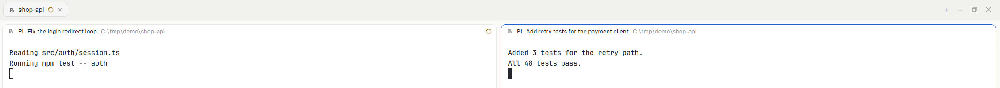

# Pane labels for Herdr

Give each pane its own title from outside the app. Set a label on the pane's
terminal, and the pane header shows it after the agent's name:

```sh
hc label t7 "pane.title=Fix the login redirect loop"
```



Two agents in one tab and one folder look the same in Herdr's shipped header
(`Pi  ~/shop-api`). With this mod, a script, a dashboard or the agent itself
names each one. Herdr has no pane name of its own, so the title is a label on
the core terminal: it stays while the terminal lives, also when the window
closes.

## Install

Ask your Herdr agent: *"add the mod at github.com/kiote/herdr-pane-labels"*.
It reads [RECIPE.md](RECIPE.md) and the files, copies the folder and points a
copy of your layout at it.

By hand:

1. Copy the mod folder:

   ```sh
   git clone https://github.com/kiote/herdr-pane-labels
   cp -R herdr-pane-labels/mods/pane-labels ~/.config/herdr-app/mods/
   ```

   Use `$HERDR_APP_HOME` instead of `~/.config/herdr-app` if you set it.

2. Copy the layout you use (Herdr updates its own layouts on start). For the
   default one, `main`:

   ```sh
   herdr-app do layout.clone --name main --as main-labels
   ```

3. In `layouts/main-labels.json`, change the pane header's
   `"mod": "pane"` to `"mod": "pane-labels"`. The window reloads it.

4. Check it: `herdr-app check ~/.config/herdr-app/mods/pane-labels`.

To go back, switch to your old layout (`ctrl-shift-l`).

## Use

| Command | Effect |
|---|---|
| `hc label <terminal> "pane.title=<title>"` | shows `<title>` in the header |
| `hc label <terminal> pane.title=` | removes it; the header is Herdr's again |
| `hc ls` | the terminal addresses (`t7`) |

Inside a Herdr terminal, `$HC_TERMINAL_ID` is its own address, so an agent
hook can name its own pane: `hc label "$HC_TERMINAL_ID" "pane.title=..."`.

The mod also reads `dashboard.title` when `pane.title` is not set.

## Optional: automatic titles from Pi

The header displays labels; it does not invent them. If you use Pi, the
[optional Pi integration](integrations/pi/README.md) lets each agent maintain
its own task label automatically during normal work:

```sh
pi install git:github.com/kiote/herdr-pane-labels
```

Install and enable the Herdr header first; the Pi package does not change your
Herdr layout. Use `/reload` once in already-running Pi sessions. Do not also
load a manual copy of the same extension.

The integration provides a project/session fallback, asks the agent to update
its title on substantive task changes, and supports manual pins:

- `/pane-title A fixed label` — pin a title.
- `/pane-title auto` — resume automatic maintenance.
- `/pane-title off` — freeze updates.

No separate AI request or background transcript scanner is used. If the agent
does not call its title tool, the previous/fallback label remains. Read the
[integration guide](integrations/pi/README.md) for requirements, privacy limits,
tests and uninstall instructions. Other agents can continue setting labels with
`hc label` directly.

## What the UI mod does not do

- It does not make titles. Something must set the label; Pi automation is optional.
- The UI mod reads only labels: no network, no programs, no files.
- It replaces the header only in the layout that points to it.

The optional Pi integration runs `hc` to update its own terminal's labels; it
does not modify the UI mod or Herdr's managed agent-status integration.

## License

Apache-2.0. The mod is a modified copy of Herdr's shipped `pane` mod; see
[NOTICE](NOTICE).
