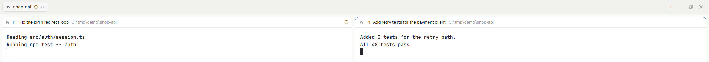

# Pane labels

A pane header for the Herdr app that shows a title from a terminal label.
`hc label t7 "pane.title=Fix the login redirect loop"` and the header of the
pane that shows `t7` reads `Pi  Fix the login redirect loop  C:\tmp\demo\shop-api`.
Without the label, the header is the same as Herdr's shipped `pane` header.

## What you see

One header on each pane, as tall as the layout's header (30px in `main`),
one row, 12px text, on the theme's `background` with a 1px `border` line
below. Left to right:

1. The program's icon, 14px (tinted `dim` when the program table says so).
2. The agent's name (`Pi`) or the terminal's title, medium weight,
   `foreground`, at most 260px, cut with an ellipsis.
3. The label title, normal weight, `foreground`, at most 420px, cut with an
   ellipsis. Not drawn when no label is set.
4. The folder, `dim`, fills the rest, cut with an ellipsis; the home folder
   shows as `~`.
5. The status on the right (see below).

## How it behaves

- Status: `working` draws the spinner (12px, `working` color, one turn in
  900ms); `blocked` draws a "Needs you" pill in the `blocked` color; `done`
  draws a 7px dot in the `done` color; `idle` draws nothing.
- Hover shows four 14px buttons on the right: split right, split down, zoom
  (unzoom when zoomed) and close. They run `pane.split`, `pane.zoom` and
  `pane.close` for this pane.
- A click anywhere else on the header focuses the pane (`pane.focus`).
- The title follows the label live: set, change or remove it with `hc label`
  and the header redraws.

## Built from

- One mod, `mods/pane-labels/` (`mod.json`: `"place": "none"`), used as a
  pane header: `"header": { "content": { "mod": "pane-labels" } }` in a copy
  of the layout.
- Props from the app: `{ pane, terminal }`.
- `herdr` functions: `panes()` (find this pane by `props().pane`),
  `terminals()` (find the terminal by `address`, read `labels`), `theme()`,
  `home()`, `run()`.
- The title is the first non-empty label of `pane.title`, then
  `dashboard.title`, trimmed.
- Art: `close.svg`, `split-down.svg`, `split-right.svg`, `unzoom.svg`,
  `zoom.svg` from Herdr's `pane` mod, at `mods/pane-labels/<name>.svg`.

## Watch out

- `terminals()` gives core terminals with `address`; `panes()` gives
  `terminal` as the same address. Compare those two. A mod pane has
  `terminal: null` and gets no title.
- The shipped layouts are Herdr's and are restored on start: point a clone
  at the mod, not `layouts/main.json`.
- Labels on a remote machine use that machine's ids, without the `machine/`
  prefix that the app shows.
- Long names: the agent's name and the title have fixed maximum widths so the
  folder keeps some room.

## Done when

- `herdr-app check mods/pane-labels` passes.
- With the layout clone shown, a pane without a label looks like Herdr's
  shipped header.
- `hc label <t> "pane.title=Test title"` shows `Test title` after the agent's
  name within a second; `hc label <t> pane.title=` removes it.
- Two panes in one tab show two different titles.
- Hover shows the four buttons, and each one acts on its own pane.
